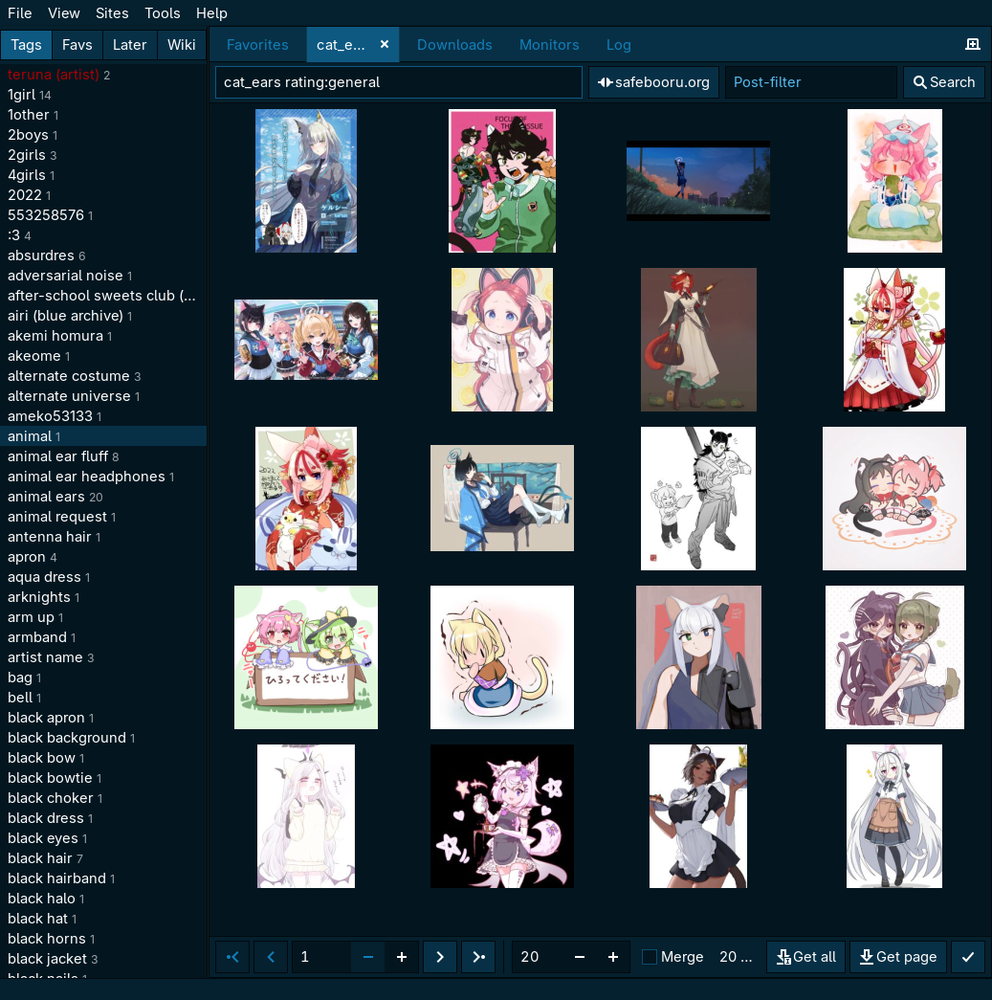
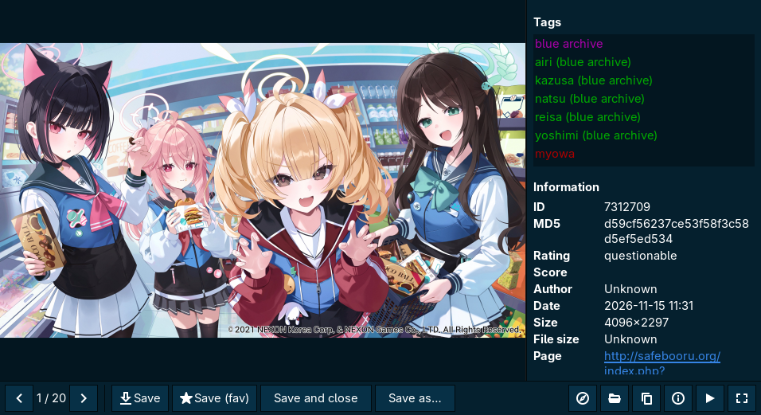

# Booru Grabber

 [](https://aur.archlinux.org/packages/booru-grabber-bin) [](https://aur.archlinux.org/packages/booru-grabber-git)

<p align="center"></p>

A Linux program that searches imageboards and boorus (Danbooru, Gelbooru, e621, Pixiv, …) and downloads images
with filenames built from their tags. It is a C++ / GTK 3 rewrite of [Grabber][upstream] by Bionus, without Qt,
with Grabber's layout, file formats and filename syntax.



| Part | Binary / file | Use it for |
|---|---|---|
| GUI | `booru-grabber` | Searching in tabs, viewing, downloading, favorites and monitors |
| CLI | `booru-grabber-cli` | Scripts: counts, tag lists, image URLs, JSON and downloads |
| Library | `libbooru-grabber.so.1` | Shared by both; not a public API |

## Features

- **27 preset sites from 26 sources**: Danbooru, Gelbooru, Moebooru (yande.re, konachan), e621, Philomena
  (Derpibooru), Shimmie, Szurubooru, Pixiv, DeviantArt, ArtStation, Reddit, Zerochan, Wallhaven, Kemono and
  more. Add your own instance of any engine in **Sites → Add site**. `booru-grabber-cli --list-sites` prints them.
- **Filenames from tokens**: `%artist%/%copyright%/%md5%.%ext%`, with conditionals, per-type rules for
  missing or multiple tags, custom tokens and JavaScript. See [docs/filenames.md](docs/filenames.md).
- **Search tabs**: several sites per tab with merged results, post-filters (`width:>=1920 -rating:explicit`),
  blacklists, tag completion, and tabs restored on start.
- **Downloads**: a download queue that resumes after a restart, an MD5 database to skip images you already have,
  and optional conversion (WebM → MP4, ugoira) via ffmpeg and metadata via exiftool.
- **Favorites and monitors**: favorite searches with thumbnails, and monitors that check them on a timer, notify
  you and can download new images.
- **Viewer**: zoom and pan, animated GIF/APNG/WebP, WebM/MP4 through GStreamer, tag and info panel, slideshow.
- **Follows the GTK theme**: colours come from the theme (pywal themes included), corners are square and the
  window has no client-side title bar.
- **Three ways to install**: system packages, a standalone folder that keeps everything next to it, or an
  AppImage.

## Installation

### Arch Linux (AUR)

| Package | Description |
|---|---|
| [`booru-grabber-bin`](https://aur.archlinux.org/packages/booru-grabber-bin) | Prebuilt x86_64 binaries from the GitHub release |
| [`booru-grabber-git`](https://aur.archlinux.org/packages/booru-grabber-git) | Built from the latest commit |

```sh
paru -S booru-grabber-bin   # or booru-grabber-git
```

Both can be installed next to the Qt Grabber: every file and folder is named `booru-grabber`.

### Release files

Each [release][releases] has three x86_64 builds. All of them use the system's GTK 3, libsoup 3, libxml2, SQLite
and gdk-pixbuf, except the AppImage, which bundles them.

| File | Install | Profile kept in |
|---|---|---|
| `booru-grabber-<version>-linux-x86_64.tar.gz` | `/usr` layout, built on Arch | `~/.config`, `~/.local/share` (see [Files](#files)) |
| `booru-grabber-<version>-portable-x86_64.tar.gz` | Extract anywhere, run `./booru-grabber` | `profile/` next to the program |
| `Booru_Grabber-<version>-x86_64.AppImage` | `chmod +x`, run it | `~/.config`, `~/.local/share` |

```sh
# System-wide, from the tarball
tar -xzf booru-grabber-1.0.0-linux-x86_64.tar.gz
cd booru-grabber-1.0.0-linux-x86_64
sudo cp -r bin lib share /usr/local/ && sudo cp -r etc/booru-grabber /etc/

# Standalone folder, e.g. on a USB drive
tar -xzf booru-grabber-1.0.0-portable-x86_64.tar.gz
./booru-grabber-1.0.0-portable-x86_64/booru-grabber
```

The tarball also needs `quickjs-ng`; the portable folder bundles it.

## Building

Requirements: a C++17 compiler, CMake 3.16+, GLib 2.74+, GTK 3.24, libsoup 3, libxml2, SQLite 3, gdk-pixbuf,
nlohmann-json 3.9+, quickjs-ng (downloaded and built if missing), and TypeScript 5.9+ (`tsc`, or `npm` to fetch
it) to compile the site sources. Optional: GStreamer 1.x for video, libayatana-appindicator for the tray icon,
Catch2 3 for the tests.

```sh
# Arch
sudo pacman -S --needed base-devel cmake ninja gtk3 libsoup3 libxml2 sqlite gdk-pixbuf2 nlohmann-json quickjs-ng \
  typescript gstreamer gst-plugins-base-libs libayatana-appindicator catch2
```

```sh
git clone --recursive https://github.com/TheElevatedOne/booru-grabber.git
cd booru-grabber
cmake -S . -B build -G Ninja -DCMAKE_BUILD_TYPE=Release -DCMAKE_INSTALL_PREFIX=/usr
cmake --build build
ctest --test-dir build        # unit tests and every site source against its sample pages
sudo cmake --install build
```

The build tree runs without installing: `./build/bin/booru-grabber`.

| CMake option | Default | Effect |
|---|---|---|
| `BOORU_GRABBER_GUI` | `ON` | Build the GTK interface |
| `BOORU_GRABBER_TESTS` | `ON` | Build the tests (needs Catch2 3) |
| `BOORU_GRABBER_TRAY` | `ON` | Tray icon when libayatana-appindicator is found |
| `BOORU_GRABBER_PORTABLE` | `OFF` | Install as one self-contained folder that keeps its profile inside |
| `BOORU_GRABBER_RELOCATABLE` | `ON` | `$ORIGIN`-relative RPATH, so the installed tree can be moved |
| `BOORU_GRABBER_FETCH_QUICKJS` | `ON` | Download quickjs-ng when it isn't installed |

`packaging/` has the scripts that make the release files: `make-release-tarball.sh`, `make-portable.sh` and
`build-appimage.sh`.

## Usage

Type tags in a search tab and press <kbd>Enter</kbd>. Click the site button to choose which sites to search.
Click a thumbnail to open the viewer, middle-click it to add it to the downloads, and <kbd>Ctrl</kbd>+click to
select several. **Get page**, **Get all** and the ✓ button (get selected) add images to the **Downloads** tab,
where **Start** downloads them. Right-click a tag for favorites, blacklist and ignore.

| Action | Shortcut |
|---|---|
| New tab / reopen closed tab / close tab | <kbd>Ctrl</kbd>+<kbd>T</kbd> / <kbd>Ctrl</kbd>+<kbd>Shift</kbd>+<kbd>T</kbd> / <kbd>Ctrl</kbd>+<kbd>W</kbd> |
| Next / previous tab | <kbd>Ctrl</kbd>+<kbd>Tab</kbd>, <kbd>Ctrl</kbd>+<kbd>PgDn</kbd> / <kbd>Ctrl</kbd>+<kbd>Shift</kbd>+<kbd>Tab</kbd>, <kbd>Ctrl</kbd>+<kbd>PgUp</kbd> |
| Focus the search field / search again | <kbd>Ctrl</kbd>+<kbd>L</kbd> / <kbd>F5</kbd> |
| Show or hide the sidebar | <kbd>F9</kbd> |
| Settings / quit | <kbd>Ctrl</kbd>+<kbd>P</kbd> / <kbd>Ctrl</kbd>+<kbd>Q</kbd> |
| Viewer: next / previous image | <kbd>→</kbd> / <kbd>←</kbd> |
| Viewer: save / save and close / save as | <kbd>Ctrl</kbd>+<kbd>S</kbd> / <kbd>Ctrl</kbd>+<kbd>W</kbd> / <kbd>Ctrl</kbd>+<kbd>Shift</kbd>+<kbd>S</kbd> (add <kbd>Alt</kbd> to save to the favorites folder) |
| Viewer: zoom in / out / toggle fit | <kbd>+</kbd> / <kbd>-</kbd> / <kbd>0</kbd> |
| Viewer: details panel / fullscreen / slideshow or pause video | <kbd>D</kbd> / <kbd>F11</kbd> / <kbd>Space</kbd> |
| Viewer: copy the image URL | <kbd>Ctrl</kbd>+<kbd>C</kbd> |



### Command line

```sh
booru-grabber-cli -t "cat_ears rating:general" -s safebooru.org --return-count
```

```text
95358
```

```sh
booru-grabber-cli -t "cat_ears rating:general" -s safebooru.org -m 3 -l ~/Pictures/cats -f "%copyright%/%md5%.%ext%" --download
```

```text
[1/3] saved: ~/Pictures/cats/arknights/aafb85d1261beca56442277347b82555.jpg
[2/3] saved: ~/Pictures/cats/dungeon meshi/bfca7985836dd78d6e9a90a049ae1fa2.png
[3/3] saved: ~/Pictures/cats/blue archive/5fe31dbf32047127d5999bedabe0cb9e.jpg
Downloaded 3, already existed 0, ignored 0, not found 0, errors 0
```

The options are the ones of `Grabber-cli`, and its two-letter forms (`-rc`, `-rt`, `-tb`, …) still work:

```text
$ booru-grabber-cli --help
Usage:
  booru-grabber-cli [OPTION…] - download images from boorus and imageboards

Application Options:
  -t, --tags=TAGS                       Tags to search for
  -s, --sources=SITES                   Source websites (space or comma separated)
  -p, --page=N                          Starting page (default 1)
  -m, --max=N                           Maximum number of returned images
  -i, --perpage=N                       Images per page (default 20)
  -l, --location=PATH                   Folder to save images in (default: Save/path setting)
  -f, --filename=FORMAT                 Filename format (default: Save/filename setting)
  -u, --user=USER                       Username to log into the sources
  -w, --password=PASSWORD               Password to log into the sources
  -b, --blacklist                       Download blacklisted images
  --tags-blacklist=TAGS                 Tags to remove from results (-tb)
  -r, --postfilter=FILTER               Filter results
  -n, --no-duplicates                   Remove duplicates from results
  -d, --debug                           Show debug messages
  --tags-min=N                          Minimum count for tags to be returned (-tm)
  --tags-format=FORMAT                  Format for returned tags (-tf, default "%tag\t%count\t%type")
  --ignore-error                        Don't exit on error
  --proxy=[user:password@]host:port     Use the given proxy
  --no-login                            Disable auto login
  -j, --json                            Output results as JSON
  --load-details                        Load the details page of each result
  --get-details=URL                     Parse the details of the given image page
  --load-tag-database                   Load the tag database of the given sources
  --return-count                        Return the total image count (-rc)
  --return-tags                         Return the tags of a search (-rt)
  --return-pure-tags                    Return the tag list of the sources (-rp)
  --return-images                       Return the found images (-ri)
  --download                            Download the found images
  --list-sites                          List the configured sites and their sources
  --profile=DIR                         Keep all settings and data in this directory
  --portable                            Keep settings and data next to the program
  --import-grabber=DIR                  Import a profile of the original Grabber (e.g. ~/.config/Bionus/Grabber) and exit
  -v, --version                         Show the version
```

The GUI takes `--profile`, `--portable`, `--import-grabber`, `--minimize` and `-d`. Links passed to it open in a
new search tab.

## Files

| What | Where |
|---|---|
| Settings (`settings.ini`, per-site `sites/<source>/<site>/settings.ini`) | `$XDG_CONFIG_HOME/booru-grabber` (`~/.config/booru-grabber`) |
| Favorites, monitors, history, download queue, MD5 database, cookies, blacklist, user sources | `$XDG_DATA_HOME/booru-grabber` (`~/.local/share/booru-grabber`) |
| HTTP cache (thumbnails included), files open in the viewer | `$XDG_CACHE_HOME/booru-grabber` |
| Log (`logs/main.log`) | `$XDG_STATE_HOME/booru-grabber` |
| System defaults | `/etc/booru-grabber/settings.ini`, then `$XDG_CONFIG_DIRS/booru-grabber/settings.ini` |
| Site sources | `/usr/share/booru-grabber/sites` |
| Downloads, when no folder is set | `$XDG_PICTURES_DIR/Booru Grabber` |

Settings missing from your `settings.ini` come from the system defaults, so an administrator or a package can
change the defaults in `/etc`.

`--profile DIR` or `BOORU_GRABBER_PROFILE=DIR` keeps everything in one folder instead. The portable build does
the same with `profile/` next to the program; a file named `portable` next to the binary, `--portable` or
`BOORU_GRABBER_PORTABLE=1` turn this on for any build.

### Coming from Grabber

Nothing is read from Grabber's `~/.config/Bionus/Grabber` unless you ask. **File → Import Grabber profile…** or
`booru-grabber --import-grabber ~/.config/Bionus/Grabber` copies its settings, favorites, monitors, view-later
and blacklist lists, MD5 database, per-site settings and tag databases. Files that would be replaced are kept
as `.bak`, and the Grabber profile isn't changed.

## Differences from Grabber 7.14

- Linux only. The Windows, macOS and Android builds, the QML interface, translations and Qt themes are gone.
- No usage statistics, updater or source registries; sources ship with the program.
- Removed: MySQL/PostgreSQL commands (SQLite stays), the "shut down after downloads" options, and the Gfycat,
  Hentai Cosplays, Sankaku, Slushe, Tumblr and Twitter sources, which were disabled upstream.
- About 20 bugs are fixed, from HTML pages truncated before parsing to endless retries and downloads looping on
  sites that ignore the page number. The full list is in [CHANGELOG.md](CHANGELOG.md).

## Reporting bugs

Open an [issue][issues] with the steps to reproduce, the site and search, and the log from
`~/.local/state/booru-grabber/logs/main.log` (run with `-d` for more detail). Site breakage is usually a change on
the site's side: say which source and when it last worked.

## License

Apache-2.0, see [LICENSE](LICENSE) and [NOTICE](NOTICE). Based on [Grabber][upstream] by Bionus and its
contributors; the icons and site sources come from it. This project isn't affiliated with Grabber or with any
of the sites.

[upstream]: https://github.com/Bionus/imgbrd-grabber
[releases]: https://github.com/TheElevatedOne/booru-grabber/releases
[issues]: https://github.com/TheElevatedOne/booru-grabber/issues
